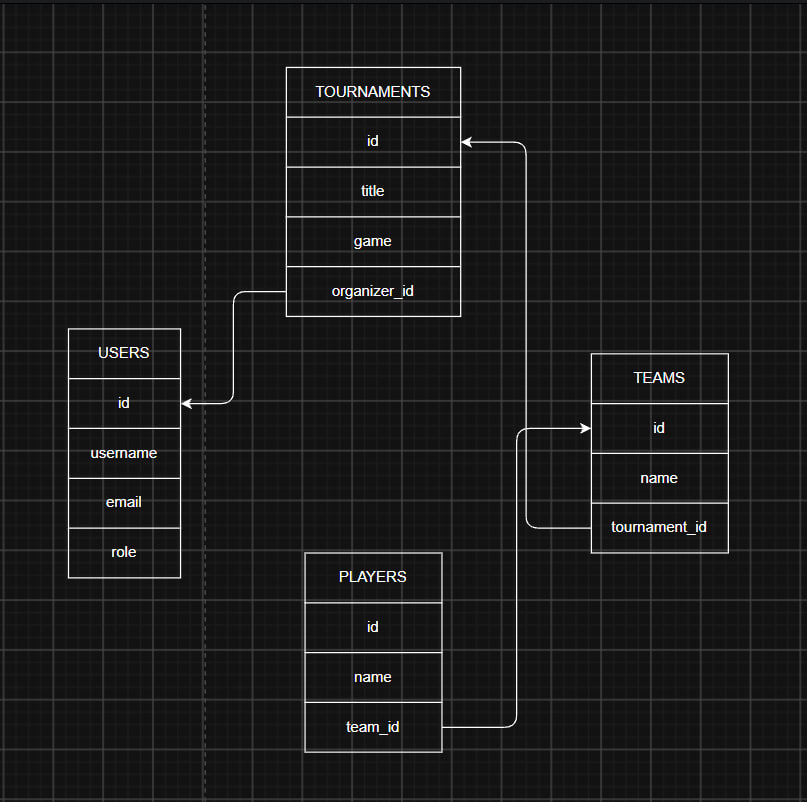

# web-programming-2026-template

A reusable Django project with no bundled application, SQLite, and Django's
standard admin, authentication, sessions, messages, and staticfiles support.

## Local setup

Requires the latest patch release of Python 3.12, 3.13, or 3.14. Run these commands from the project directory containing
`manage.py`.

1. Create and activate a virtual environment:

   ```bash
   python -m venv .venv
   
   # for linux/macos
   source .venv/bin/activate
   # for Windows:
   .venv\Scripts\activate
   ```

2. Install dependencies:

   ```bash
   python -m pip install -r requirements-dev.txt
   ```


3. Apply migrations to create the local SQLite database:

   ```bash
   python manage.py migrate
   ```

4. Start the development server:

   ```bash
   python manage.py runserver
   ```

## Endpoints

With the server running at `http://127.0.0.1:8000`:

| URL | Behavior |
| --- | --- |
| http://127.0.0.1:8000/ | No application homepage; may show Django's development welcome page while `DEBUG = True` |
| http://127.0.0.1:8000/admin/ | Django admin, available after applying migrations |

With `DEBUG = False`, unmatched URLs such as `/` return HTTP 404.

To create an account for admin login, run this after applying migrations:

```bash
python manage.py createsuperuser
```

## Add your first application

1. Create an app from the directory containing `manage.py` (replace `myapp`
   with your application name):

   ```bash
   python manage.py startapp myapp
   ```

2. Add its generated configuration class, `myapp.apps.MyappConfig`, to
   `INSTALLED_APPS` in `config/settings.py`.
3. Define your views and create `myapp/urls.py` with their URL patterns.
4. Register that URLconf in `config/urls.py` using `path()` and `include()`,
   choosing a URL prefix for the app and retaining the admin route.

See the official Django 6.1 tutorial for
[views and URL registration](https://docs.djangoproject.com/en/6.1/intro/tutorial01/)
and [app registration and models](https://docs.djangoproject.com/en/6.1/intro/tutorial02/).

## Start a REST API

Django REST framework and `django-cors-headers` are included and configured.
Install the project dependencies with `python -m pip install -r requirements-dev.txt`.
Create your own app, serializers, views, and URL patterns; no API app or
authentication scheme is supplied.

## Git attributes

Git detects text files automatically and normalizes them to LF. Checkouts use
LF on Linux and Windows, while `.bat` and `.cmd` files use CRLF. Binary files
are auto-detected and left unchanged, helping avoid newline-only diffs.


## Code style and submission verification

All submissions are required to adhere to PEP-8, Django best practices, and standard HTML/CSS/JS formatting. A deterministic cross-platform utility is provided to help you check and format your code.

### 1. Verification (Check Mode)
Before submitting, verify that all files adhere to the required standards:

```bash
python check_submission.py
```

Passing these checks confirms code style, not functional API behavior. Before submitting an API, also write and run functional tests for its endpoints. If style checks fail, review the error output or run the auto-formatter below.

### 2. Auto-Formatting
To automatically format Python files, fix safe PEP-8 rules, format Django HTML templates, and format CSS/JS static files:

```bash
python check_submission.py --format
```

### 3. PyCharm Integration
If you use PyCharm:
- **One-Click Run:** In the top-right toolbar run configurations dropdown, select **"Verify Submission"** or **"Format Project"** and click the green **Play** button.

## Development only

The included settings use `DEBUG = True`, a development secret key, and a local
SQLite database. The default mailer uses the console backend: email is printed
to the process's console instead of being delivered.

This configuration and Django's development server are not suitable for
production deployment.


# Tournament Tracker API

## Опис ідеї
**Tournament Tracker** - це платформа для створення, управління та відстеження студентських кіберспортивних турнірів. Сайт дозволяє організаторам створювати турніри, реєструвати команди та гравців, керувати розкладом матчів і оновлювати турнірні сітки та результати ігор. Користувачі можуть переглядати актуальні матчі, склади команд і статистику.

## Архітектура REST API

## Архітектура REST API

### Турніри

- **Отримати список усіх турнірів**
  * **Method:** GET
  * **Response Status:** 200 OK
  * **Response Body:**
    ```json
    [
      {
        "id": 1,
        "title": "Kyiv Cup 2026",
        "start_date": "2026-06-01",
        "end_date": "2026-06-05",
        "game": "CS2",
        "organizer_id": 1,
        "teams": []
      }
    ]
    ```

- **Отримати конкретний турнір за ID**
  * **Method:** GET
  * **Response Status:** 200 OK
  * **Response Body:**
    ```json
    {
      "id": 1,
      "title": "Kyiv Cup 2026",
      "start_date": "2026-06-01",
      "end_date": "2026-06-05",
      "game": "CS2",
      "organizer_id": 1,
      "teams": []
    }
    ```

- **Створити новий турнір**
  * **Method:** POST
  * **Request Body:**
    ```json
    {
      "title": "Kyiv Cup 2026",
      "start_date": "2026-06-01",
      "end_date": "2026-06-05",
      "game": "CS2",
      "organizer_id": 1
    }
    ```
  * **Response Status:** 201 Created

- **Повністю оновити турнір**
  * **Method:** PUT
  * **Request Body:**
    ```json
    {
      "title": "Kyiv Cup 2026 Updated",
      "start_date": "2026-06-01",
      "end_date": "2026-06-07",
      "game": "CS2",
      "organizer_id": 1
    }
    ```
  * **Response Status:** 200 OK

- **Частково оновити турнір**
  * **Method:** PATCH
  * **Request Body:**
    ```json
    {
      "title": "New Title Only"
    }
    ```
  * **Response Status:** 200 OK

- **Видалити турнір (Помилка: якщо є команди)**
  * **Method:** DELETE
  * **Response Status:** 400 Bad Request
  * **Response Body:**
    ```json
    {
      "error": "Неможливо видалити турнір 'Kyiv Cup 2026', оскільки до нього прив'язано команд: 1."
    }
    ```

- **Успішно видалити турнір**
  * **Method:** DELETE
  * **Response Status:** 204 No Content (або 200 OK)


### Команди

- **Отримати список команд**
  * **Method:** GET
  * **Response Status:** 200 OK
  * **Response Body:**
    ```json
    [
      {
        "id": 2,
        "name": "Team Alpha",
        "tournament": 2,
        "players": []
      }
    ]
    ```

- **Отримати конкретну команду за ID**
  * **Method:** GET
  * **Response Status:** 200 OK
  * **Response Body:**
    ```json
    {
      "id": 2,
      "name": "Team Alpha",
      "tournament": 2,
      "players": []
    }
    ```

- **Зареєструвати нову команду**
  * **Method:** POST
  * **Request Body:**
    ```json
    {
      "name": "Team Alpha",
      "tournament": 2
    }
    ```
  * **Response Status:** 201 Created

- **Повністю оновити команду**
  * **Method:** PUT
  * **Request Body:**
    ```json
    {
      "name": "Team Alpha Updated",
      "tournament": 2
    }
    ```
  * **Response Status:** 200 OK

- **Видалити команду (Помилка: якщо є гравці)**
  * **Method:** DELETE
  * **Response Status:** 400 Bad Request
  * **Response Body:**
    ```json
    {
      "error": "Неможливо видалити команду 'Team Alpha', оскільки в ній зареєстровано гравців: 1."
    }
    ```

- **Успішно видалити команду**
  * **Method:** DELETE
  * **Response Status:** 204 No Content (або 200 OK)


### Гравці

- **Отримати список гравців**
  * **Method:** GET
  * **Response Status:** 200 OK
  * **Response Body:**
    ```json
    [
      {
        "id": 1,
        "name": "Олександр",
        "nickname": "monkey",
        "team": 1
      }
    ]
    ```

- **Отримати конкретного гравця за ID**
  * **Method:** GET
  * **Response Status:** 200 OK
  * **Response Body:**
    ```json
    {
      "id": 1,
      "name": "Олександр",
      "nickname": "monkey",
      "team": 1
    }
    ```

- **Створити нового гравця**
  * **Method:** POST
  * **Request Body:**
    ```json
    {
      "name": "Олександр",
      "nickname": "monkey",
      "team": 1
    }
    ```
  * **Response Status:** 201 Created

- **Повністю оновити гравця**
  * **Method:** PUT
  * **Request Body:**
    ```json
    {
      "nickname": "mones",
      "team": "2"
    }
    ```
  * **Response Status:** 200 OK

## Схема бази даних



## Авторизація та JWT

Проєкт використовує бібліотеку `djangorestframework-simplejwt` для токен-автентифікації та розмежування прав доступу.

### Заголовки запитів (Headers)
Для виконання захищених запитів (`POST`, `PUT`, `PATCH`, `DELETE`) у заголовку (`Headers`) необхідно передавати дійсний access-токен у такому форматі:
* **Authorization:** `Bearer <ваш_access_token>`

### Ендпоінти авторизації та користувачів (`/api/auth/`)

- **Реєстрація користувача**
  * **Method:** POST
  * **Endpoint:** `/api/auth/register/`
  * **Request Body:**
    ```json
    {
      "username": "student_test",
      "email": "student@example.com",
      "password": "SecurePassword123!",
      "password_confirmation": "SecurePassword123!",
      "first_name": "Інна",
      "last_name": "Бурдейна"
    }
    ```
  * **Validation:** Перевіряється заповнення обов'язкових полів, формат email, мінімальна довжина пароля (від 8 символів), збіг `password` та `password_confirmation`, а також складність пароля (наявність великих/малих літер, цифр та спеціальних символів).
  * **Response Status:** 201 Created або 400 Bad Request (при помилках валідації).

- **Отримання JWT токена (Логін)**
  * **Method:** POST
  * **Endpoint:** `/api/auth/login/`
  * **Request Body:**
    ```json
    {
      "username": "student_test",
      "password": "SecurePassword123!"
    }
    ```
  * **Response Status:** 200 OK (повертає пари `access` та `refresh` токенів).

- **Оновлення Access-токена (Refresh)**
  * **Method:** POST
  * **Endpoint:** `/api/auth/token/refresh/`
  * **Request Body:**
    ```json
    {
      "refresh": "<ваш_refresh_token>"
    }
    ```
  * **Response Status:** 200 OK (повертає новий `access`-токен).